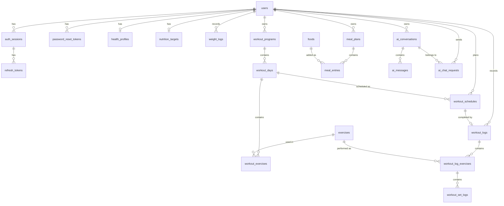

# Thiết kế database — VieGym MVP

**DBMS:** PostgreSQL 17 (`infra/compose.yaml`). Migration sẽ viết bằng Flyway ở ngày 3.

## 1. Quy ước chung

| Nội dung | Quy ước |
|---|---|
| Tên bảng/cột | `snake_case`, bảng số nhiều |
| Khóa chính | `id UUID DEFAULT gen_random_uuid()` |
| Thời điểm | `TIMESTAMPTZ`, lưu UTC |
| Ngày nghiệp vụ | `DATE` — ngày theo múi giờ của user (xem `04-business-rules.md`) |
| Số liệu cần cộng dồn | `NUMERIC(p,s)`, không dùng `FLOAT/DOUBLE` |
| Enum | `VARCHAR` + `CHECK (... IN (...))` để dễ migrate, map sang Java enum |
| Audit | Bảng có dữ liệu sửa được có `created_at`, `updated_at` (`NOT NULL DEFAULT now()`); bảng chỉ thêm (log, message) có `created_at` |
| Xóa | Danh mục (`exercises`, `foods`) và tài khoản ẩn bằng cờ/trạng thái, không xóa cứng |
| Khóa ngoại | Mặc định `ON DELETE RESTRICT`; chỉ `CASCADE` từ cha sang con thuần túy thuộc cùng một aggregate (ghi rõ từng chỗ) |

## 2. ERD



Bản văn bản:

```text
User → AuthSession                 1–n
AuthSession → RefreshToken         1–n
User → HealthProfile               1–0..1
User → NutritionTarget             1–0..1
User → WeightLog                   1–n
User → WorkoutProgram              1–n   (giáo án mẫu: user_id NULL)
WorkoutProgram → WorkoutDay        1–n
WorkoutDay → WorkoutExercise       1–n
Exercise → WorkoutExercise         1–n

User → WorkoutSchedule             1–n
WorkoutDay → WorkoutSchedule       1–n
User → WorkoutLog                  1–n
WorkoutSchedule → WorkoutLog       1–0..1
WorkoutLog → WorkoutLogExercise    1–n
Exercise → WorkoutLogExercise      1–n
WorkoutLogExercise → WorkoutSetLog 1–n

User → MealPlan                    1–n
MealPlan → MealEntry               1–n
Food → MealEntry                   1–n

User → AiConversation              1–n
AiConversation → AiMessage         1–n
User → AiChatRequest               1–n
AiConversation → AiChatRequest     1–n
```

## 3. Nhóm tài khoản

### `users`

| Cột | Kiểu | Quy tắc |
|---|---|---|
| `id` | UUID | PK |
| `email` | VARCHAR(254) | Bắt buộc; lưu dạng đã chuẩn hóa (trim + lowercase); **UNIQUE** |
| `password_hash` | VARCHAR(255) | Bắt buộc; BCrypt có tiền tố `{bcrypt}`, không lưu mật khẩu gốc |
| `full_name` | VARCHAR(100) | Bắt buộc, không rỗng |
| `role` | VARCHAR(10) | `USER` \| `ADMIN`, mặc định `USER` |
| `status` | VARCHAR(10) | `ACTIVE` \| `LOCKED`, mặc định `ACTIVE` |
| `timezone` | VARCHAR(50) | Mặc định `Asia/Ho_Chi_Minh` (IANA) |
| `created_at`, `updated_at` | TIMESTAMPTZ | Bắt buộc |

### `auth_sessions`

Một lần đăng nhập trên một thiết bị. Access token mang `sid` = `id`; mọi request riêng tư kiểm tra phiên còn hiệu lực (ngày 4, `09-auth-design.md`).

| Cột | Kiểu | Quy tắc |
|---|---|---|
| `id` | UUID | PK |
| `user_id` | UUID | FK → `users`, bắt buộc |
| `expires_at` | TIMESTAMPTZ | Bắt buộc; hạn tuyệt đối 30 ngày, refresh không kéo dài |
| `revoked_at` | TIMESTAMPTZ | NULL = còn hiệu lực; đặt khi logout hoặc phát hiện dùng lại refresh |
| `created_at` | TIMESTAMPTZ | Bắt buộc |

Index: `(user_id)`.

### `refresh_tokens`

| Cột | Kiểu | Quy tắc |
|---|---|---|
| `id` | UUID | PK |
| `session_id` | UUID | FK → `auth_sessions`, bắt buộc |
| `token_hash` | CHAR(64) | SHA‑256 của token; **UNIQUE**. Không lưu token gốc |
| `expires_at` | TIMESTAMPTZ | Bắt buộc; không vượt `auth_sessions.expires_at` |
| `consumed_at` | TIMESTAMPTZ | NULL = chưa dùng; đặt khi đổi lấy token mới. Gửi lại token đã consumed → thu hồi mọi phiên của user (BR-A04) |
| `revoked_at` | TIMESTAMPTZ | NULL = chưa bị thu hồi |
| `created_at` | TIMESTAMPTZ | Bắt buộc |

Index: `(session_id)`. Thay thiết kế ngày 2 (`user_id`, `replaced_by_id`): token gắn với phiên để logout thu hồi đúng một thiết bị.

### `password_reset_tokens`

| Cột | Kiểu | Quy tắc |
|---|---|---|
| `id` | UUID | PK |
| `user_id` | UUID | FK → `users`, bắt buộc |
| `token_hash` | CHAR(64) | SHA‑256 của `userId:mã` (ngày 13 — cùng mã ở hai user ra hash khác nhau); **không** UNIQUE vì mã 6 chữ số có thể trùng |
| `expires_at` | TIMESTAMPTZ | Bắt buộc (15 phút sau khi tạo) |
| `used_at` | TIMESTAMPTZ | NULL = chưa dùng |
| `attempt_count` | SMALLINT | Mặc định 0; số lần nhập sai, đạt 5 thì vô hiệu mã (BR-A06). CHECK 0–5 |
| `created_at` | TIMESTAMPTZ | Bắt buộc |

Index: `(user_id, created_at DESC)`. Tra mã theo user (từ email) rồi so sánh hash; tạo mã mới thì vô hiệu các mã chưa dùng trước đó của user.

## 4. Nhóm sức khỏe

### `health_profiles`

| Cột | Kiểu | Quy tắc |
|---|---|---|
| `id` | UUID | PK |
| `user_id` | UUID | FK → `users`; **UNIQUE** (một hồ sơ/user) |
| `sex` | VARCHAR(6) | `MALE` \| `FEMALE` — giới tính dùng trong công thức BMR |
| `date_of_birth` | DATE | Bắt buộc; tuổi hợp lệ theo `04-business-rules.md` |
| `height_cm` | NUMERIC(4,1) | 100,0–250,0 |
| `weight_kg` | NUMERIC(4,1) | 30,0–300,0; cân nặng dùng để tính mục tiêu hiện tại |
| `activity_level` | VARCHAR(12) | `SEDENTARY` \| `LIGHT` \| `MODERATE` \| `ACTIVE` \| `VERY_ACTIVE` |
| `goal` | VARCHAR(12) | `LOSE_WEIGHT` \| `MAINTAIN` \| `GAIN_MUSCLE` |
| `created_at`, `updated_at` | TIMESTAMPTZ | Bắt buộc |

### `nutrition_targets`

Kết quả tính từ `health_profiles`; ghi lại cùng giao dịch khi lưu hồ sơ.

| Cột | Kiểu | Quy tắc |
|---|---|---|
| `id` | UUID | PK |
| `user_id` | UUID | FK → `users`; **UNIQUE** |
| `bmi` | NUMERIC(5,2) | > 0; dải đầu vào hợp lệ cho BMI tới 300,00 |
| `bmr_kcal` | NUMERIC(6,1) | > 0 |
| `tdee_kcal` | NUMERIC(6,1) | > 0 |
| `target_kcal` | NUMERIC(6,1) | > 0 |
| `protein_g` | NUMERIC(5,1) | ≥ 0 |
| `carbs_g` | NUMERIC(5,1) | ≥ 0 |
| `fat_g` | NUMERIC(5,1) | ≥ 0 |
| `kcal_floor_applied` | BOOLEAN | Bắt buộc; mục tiêu bị nâng lên ngưỡng dưới (`04-business-rules.md` §3.4). Thêm ở ngày 5 vì GET không tính lại |
| `formula_version` | VARCHAR(20) | Ví dụ `MSJ-v1`; giúp truy vết khi đổi công thức |
| `calculated_at` | TIMESTAMPTZ | Bắt buộc |
| `created_at`, `updated_at` | TIMESTAMPTZ | Bắt buộc |

### `weight_logs`

| Cột | Kiểu | Quy tắc |
|---|---|---|
| `id` | UUID | PK |
| `user_id` | UUID | FK → `users`, bắt buộc |
| `log_date` | DATE | Bắt buộc; không ở tương lai theo múi giờ user |
| `weight_kg` | NUMERIC(4,1) | 30,0–300,0 |
| `note` | VARCHAR(500) | NULL |
| `created_at`, `updated_at` | TIMESTAMPTZ | Bắt buộc |

Ràng buộc: **UNIQUE (`user_id`, `log_date`)** — nhập lại cùng ngày thì cập nhật (upsert); index của UNIQUE dùng luôn cho đọc theo user + khoảng ngày. CHECK `weight_kg` 30,0–300,0. Tạo ở V13 (ngày 13); không nhập lịch sử từ `health_profiles.weight_kg` vì hồ sơ không có ngày đo (docs/29 §1).

## 5. Nhóm luyện tập

### `exercises`

| Cột | Kiểu | Quy tắc |
|---|---|---|
| `id` | UUID | PK |
| `code` | VARCHAR(100) | Bắt buộc, UNIQUE; mã ổn định cho seed/import (ngày 6) |
| `name` | VARCHAR(150) | Bắt buộc; UNIQUE theo `lower(name)` |
| `name_search` | VARCHAR(150) | Tên bỏ dấu, lowercase — phục vụ tìm kiếm tiếng Việt |
| `muscle_group` | VARCHAR(20) | `CHEST` \| `BACK` \| `SHOULDERS` \| `ARMS` \| `LEGS` \| `GLUTES` \| `CORE` \| `FULL_BODY` \| `CARDIO` |
| `equipment` | VARCHAR(20) | `NONE` \| `DUMBBELL` \| `BARBELL` \| `MACHINE` \| `CABLE` \| `BAND` \| `OTHER` |
| `difficulty` | VARCHAR(12) | `BEGINNER` \| `INTERMEDIATE` \| `ADVANCED` |
| `instructions` | TEXT | Bắt buộc; mỗi dòng một bước |
| `common_mistakes` | TEXT | Bắt buộc; mỗi dòng một lỗi (ngày 6) |
| `thumbnail_url` | VARCHAR(500) | NULL; ảnh nhỏ cho danh sách (ngày 6) |
| `media_type` | VARCHAR(10) | `IMAGE` \| `GIF` \| `VIDEO`; NULL khi và chỉ khi `media_url` NULL (ngày 6) |
| `media_url` | VARCHAR(500) | NULL; URL tuyệt đối hoặc key tương đối dưới `/media/` (backend ghép host) |
| `is_active` | BOOLEAN | Mặc định `true`; ẩn thay vì xóa |
| `content_source`, `media_license` | VARCHAR(500) | NULL; nguồn nội dung và quyền dùng media (ngày 6) |
| `created_at`, `updated_at` | TIMESTAMPTZ | Bắt buộc |

Index: `(is_active, muscle_group, equipment, difficulty)`. Tìm tên dùng `LIKE '%…%'` trên `name_search`, B-tree không hỗ trợ; vài chục bài thì quét bảng là đủ, cần thì thêm `pg_trgm`. Chi tiết: `13-exercise-library-design.md`.

### `workout_programs`

| Cột | Kiểu | Quy tắc |
|---|---|---|
| `id` | UUID | PK |
| `user_id` | UUID | FK → `users`; **NULL = giáo án mẫu** do admin/seed tạo |
| `name` | VARCHAR(100) | Bắt buộc |
| `description` | VARCHAR(1000) | NULL |
| `is_template` | BOOLEAN | `true` khi `user_id IS NULL` (CHECK đảm bảo đồng nhất) |
| `is_active` | BOOLEAN | Mặc định `false` |
| `source_template_id` | UUID | FK → `workout_programs`, NULL; giáo án mẫu được sao chép từ đâu |
| `version` | INTEGER | Mặc định 0; khóa lạc quan (JPA `@Version`), PUT gửi kèm, lệch → 409 [Thêm ngày 7, docs/16] |
| `created_at`, `updated_at` | TIMESTAMPTZ | Bắt buộc |

Ràng buộc: **partial UNIQUE (`user_id`) WHERE `is_active`** — một giáo án đang hoạt động/user; CHECK `is_template = (user_id IS NULL)` và mẫu không active.
User "chọn giáo án mẫu" = backend **sao chép** mẫu thành giáo án của user; sửa bản sao không ảnh hưởng mẫu.

### `workout_days`

| Cột | Kiểu | Quy tắc |
|---|---|---|
| `id` | UUID | PK |
| `program_id` | UUID | FK → `workout_programs`, `ON DELETE CASCADE` |
| `day_order` | SMALLINT | ≥ 1 |
| `name` | VARCHAR(100) | Bắt buộc, ví dụ "Buổi A — Thân trên" |
| `archived_at` | TIMESTAMPTZ | NULL; buổi bị gỡ khỏi giáo án nhưng còn lịch tham chiếu |
| `created_at`, `updated_at` | TIMESTAMPTZ | Bắt buộc |

Ràng buộc: partial UNIQUE (`program_id`, `day_order`) WHERE `archived_at IS NULL`.
Đổi thứ tự buổi khi `PUT /workout-programs`: partial index không DEFERRABLE được, nên trước hết gán tạm `day_order = day_order + 100` cho các buổi giữ lại, sau đó đánh lại từ 1 theo thứ tự trong body.

### `workout_exercises`

| Cột | Kiểu | Quy tắc |
|---|---|---|
| `id` | UUID | PK |
| `workout_day_id` | UUID | FK → `workout_days`, `ON DELETE CASCADE` |
| `exercise_id` | UUID | FK → `exercises`, RESTRICT |
| `order_no` | SMALLINT | ≥ 1; UNIQUE (`workout_day_id`, `order_no`) |
| `target_sets` | SMALLINT | 1–10 |
| `target_reps` | SMALLINT | 1–100 |
| `rest_seconds` | SMALLINT | 0–600 |
| `created_at`, `updated_at` | TIMESTAMPTZ | Bắt buộc |

Thêm ngày 7: UNIQUE (`workout_day_id`, `exercise_id`) — một bài không lặp trong cùng buổi.
Khi sửa giáo án: xóa toàn bộ `workout_exercises` của buổi rồi INSERT lại theo body (không UPDATE `order_no` từng dòng). An toàn vì log không tham chiếu bảng này.

### `workout_schedules`

| Cột | Kiểu | Quy tắc |
|---|---|---|
| `id` | UUID | PK |
| `user_id` | UUID | FK → `users`, bắt buộc |
| `workout_day_id` | UUID | FK → `workout_days`, bắt buộc; phải thuộc giáo án của cùng user |
| `scheduled_date` | DATE | Bắt buộc; ngày theo múi giờ user |
| `start_time` | TIME | NULL; giờ địa phương dự kiến |
| `status` | VARCHAR(10) | `SCHEDULED` \| `COMPLETED` \| `CANCELLED` |
| `note` | VARCHAR(500) | NULL |
| `created_at`, `updated_at` | TIMESTAMPTZ | Bắt buộc |

Index: (`user_id`, `scheduled_date`).

### `workout_logs`

| Cột | Kiểu | Quy tắc |
|---|---|---|
| `id` | UUID | PK |
| `user_id` | UUID | FK → `users`, bắt buộc |
| `schedule_id` | UUID | FK → `workout_schedules`; **UNIQUE** — chống tạo trùng log cho một lịch. NULL dành cho tập tự do (ngoài MVP) |
| `workout_date` | DATE | Bắt buộc; lấy từ `scheduled_date` |
| `workout_name_snapshot` | VARCHAR(100) | Tên buổi lúc hoàn thành |
| `program_name_snapshot` | VARCHAR(100) | Tên giáo án lúc hoàn thành [Ngày 8] |
| `started_at`, `ended_at` | TIMESTAMPTZ | NULL; CHECK `ended_at >= started_at` khi cả hai có giá trị |
| `note` | VARCHAR(1000) | NULL |
| `created_at` | TIMESTAMPTZ | Bắt buộc |

Index: (`user_id`, `workout_date` DESC, `created_at` DESC). Ngày 8: thêm UNIQUE (`workout_log_id`, `exercise_id`) ở `workout_log_exercises` (một bài một lần trong log). Thiết kế: `18-workout-log-design.md`.

### `workout_log_exercises`

| Cột | Kiểu | Quy tắc |
|---|---|---|
| `id` | UUID | PK |
| `workout_log_id` | UUID | FK → `workout_logs`, `ON DELETE CASCADE` |
| `exercise_id` | UUID | FK → `exercises`, RESTRICT |
| `exercise_name_snapshot` | VARCHAR(150) | Tên bài lúc ghi |
| `order_no` | SMALLINT | ≥ 1; UNIQUE (`workout_log_id`, `order_no`) |
| `created_at` | TIMESTAMPTZ | Bắt buộc |

### `workout_set_logs`

| Cột | Kiểu | Quy tắc |
|---|---|---|
| `id` | UUID | PK |
| `log_exercise_id` | UUID | FK → `workout_log_exercises`, `ON DELETE CASCADE` |
| `set_no` | SMALLINT | ≥ 1; UNIQUE (`log_exercise_id`, `set_no`) |
| `reps` | SMALLINT | 1–1000 |
| `weight_kg` | NUMERIC(5,2) | 0–999,99; 0 = không dùng tạ ngoài |
| `created_at` | TIMESTAMPTZ | Bắt buộc |

## 6. Nhóm dinh dưỡng

### `foods`

| Cột | Kiểu | Quy tắc |
|---|---|---|
| `id` | UUID | PK |
| `code` | VARCHAR(30) | [Ngày 9] Mã nguồn (vd. `VPF-000272`), UNIQUE — khóa nhập lại |
| `name` | VARCHAR(150) | Bắt buộc. [Ngày 9] **Không** UNIQUE: nguồn có cùng món đo ở vùng khác (docs/20 §2) |
| `name_en` | VARCHAR(200) | [Ngày 9] NULL |
| `name_search` | VARCHAR(150) | Bỏ dấu, lowercase — "pho bo" tìm được "Phở bò" |
| `category_id` | UUID | [Ngày 9] FK → `food_categories` (code, name, sort_order) |
| `region` | VARCHAR(3) | [Ngày 9] Vùng đo nguồn `VPF`/`HAN`/`HAP`/`SFF` |
| `serving_size` | NUMERIC(7,2) | > 0, ví dụ 500. [Ngày 9] NULL khi nguồn không ghi khối lượng (cùng NULL với unit) |
| `serving_unit` | VARCHAR(20) | `g` \| `ml` |
| `serving_description` | VARCHAR(100) | Ví dụ "1 tô vừa", "1 phần ăn theo nguồn" |
| `kcal_per_serving` | NUMERIC(7,2) | ≥ 0 |
| `protein_per_serving` | NUMERIC(6,2) | gram, ≥ 0 |
| `carbs_per_serving` | NUMERIC(6,2) | gram, ≥ 0 |
| `fat_per_serving` | NUMERIC(6,2) | gram, ≥ 0 |
| `data_quality` | VARCHAR(10) | [Ngày 9] `SOURCED` \| `ESTIMATED` \| `DEMO` |
| `source` | VARCHAR(200) | Nguồn dữ liệu dinh dưỡng, bắt buộc (kèm mã bản ghi nguồn) |
| `source_url`, `image_url` | VARCHAR(500) | [Ngày 9] NULL; ảnh là link tới nguồn |
| `review_note` | VARCHAR(300) | [Ngày 9] Lý do ẩn chờ rà |
| `is_active` | BOOLEAN | Mặc định `true`; ẩn thay vì xóa |
| `revision` | INTEGER | [Ngày 9] Tăng khi số liệu đổi |
| `created_at`, `updated_at` | TIMESTAMPTZ | Bắt buộc |

Thiết kế ngày 9: `20-food-data-policy.md`.

### `meal_plans`

| Cột | Kiểu | Quy tắc |
|---|---|---|
| `id` | UUID | PK |
| `user_id` | UUID | FK → `users`, bắt buộc |
| `plan_date` | DATE | Bắt buộc |
| `created_at`, `updated_at` | TIMESTAMPTZ | Bắt buộc |

Ràng buộc: **UNIQUE (`user_id`, `plan_date`)** — một thực đơn/user/ngày. [Ngày 10] Service khóa hàng `users` trước khi tìm/tạo nên hai request đồng thời chạy tuần tự; UNIQUE là lớp bảo vệ cuối (docs/23 §4).

### `meal_entries`

| Cột | Kiểu | Quy tắc |
|---|---|---|
| `id` | UUID | PK |
| `meal_plan_id` | UUID | FK → `meal_plans`, `ON DELETE CASCADE` |
| `food_id` | UUID | FK → `foods`, RESTRICT |
| `food_revision` | INTEGER | [Ngày 10] `foods.revision` lúc thêm |
| `meal_type` | VARCHAR(10) | `BREAKFAST` \| `LUNCH` \| `DINNER` \| `SNACK` |
| `servings` | NUMERIC(5,2) | > 0 và ≤ 20 |
| `food_name_snapshot` | VARCHAR(150) | Tên món lúc thêm |
| `serving_size_snapshot` | NUMERIC(7,2) | Khẩu phần chuẩn lúc thêm; [Ngày 10] NULL khi nguồn không ghi khối lượng |
| `serving_unit_snapshot` | VARCHAR(20) | Đơn vị lúc thêm; NULL cùng `serving_size_snapshot` |
| `serving_description_snapshot` | VARCHAR(100) | [Ngày 10] Mô tả khẩu phần lúc thêm, bắt buộc |
| `kcal_per_serving_snapshot` | NUMERIC(7,2) | Kcal một khẩu phần lúc thêm |
| `protein_per_serving_snapshot` | NUMERIC(6,2) | |
| `carbs_per_serving_snapshot` | NUMERIC(6,2) | |
| `fat_per_serving_snapshot` | NUMERIC(6,2) | |
| `data_quality_snapshot` | VARCHAR(10) | [Ngày 10] `SOURCED` \| `ESTIMATED` \| `DEMO` lúc thêm |
| `created_at`, `updated_at` | TIMESTAMPTZ | Bắt buộc |

Index: (`meal_plan_id`, `created_at`, `id`), (`food_id`). Thiết kế ngày 10: `23-meal-planner-design.md`.

**Vì sao snapshot?** Admin sửa dinh dưỡng món thì thực đơn đã ghi vẫn giữ số liệu cũ. Sửa khẩu phần một mục chỉ đổi `servings`, tính lại bằng snapshot, không đọc lại `foods`. Tương tự, `workout_*_logs` lưu reps/mức tạ thực tế và tên bài, độc lập với giáo án.

## 7. Nhóm AI

### `ai_conversations`

| Cột | Kiểu | Quy tắc |
|---|---|---|
| `id` | UUID | PK |
| `user_id` | UUID | FK → `users`, bắt buộc |
| `title` | VARCHAR(150) | Bắt buộc; mặc định 60 ký tự đầu của câu hỏi đầu tiên |
| `last_message_at` | TIMESTAMPTZ | Sắp xếp danh sách |
| `created_at`, `updated_at` | TIMESTAMPTZ | Bắt buộc |

Index: (`user_id`, `last_message_at DESC`).

### `ai_messages`

| Cột | Kiểu | Quy tắc |
|---|---|---|
| `id` | UUID | PK |
| `conversation_id` | UUID | FK → `ai_conversations`, `ON DELETE CASCADE` |
| `role` | VARCHAR(10) | `USER` \| `ASSISTANT` |
| `content` | TEXT | Bắt buộc; USER ≤ 2.000 ký tự |
| `created_at` | TIMESTAMPTZ | Bắt buộc |

Index: (`conversation_id`, `created_at`).

### `ai_chat_requests`

Lưu trạng thái xử lý một lần gửi câu hỏi (UC10 — chốt vị trí lưu "thông tin xử lý yêu cầu"). Tách khỏi `ai_messages` để xử lý gửi lặp kể cả khi request tạo hội thoại mới.

| Cột | Kiểu | Quy tắc |
|---|---|---|
| `id` | UUID | PK |
| `user_id` | UUID | FK → `users`, bắt buộc |
| `client_request_id` | UUID | Do app sinh cho mỗi lần bấm "Gửi" |
| `conversation_id` | UUID | FK → `ai_conversations`, bắt buộc |
| `user_message_id` | UUID | FK → `ai_messages`, bắt buộc |
| `assistant_message_id` | UUID | FK → `ai_messages`, NULL đến khi thành công |
| `status` | VARCHAR(10) | `PROCESSING` \| `SUCCEEDED` \| `FAILED` |
| `error_code` | VARCHAR(50) | NULL; ví dụ `AI_TIMEOUT`, `AI_UPSTREAM_ERROR`, `AI_EMPTY_RESPONSE` |
| `attempt_count` | SMALLINT | Mặc định 1 |
| `model` | VARCHAR(100) | Model đã dùng |
| `prompt_tokens`, `completion_tokens` | INTEGER | NULL |
| `created_at`, `updated_at` | TIMESTAMPTZ | Bắt buộc |
| `completed_at` | TIMESTAMPTZ | NULL |

Ràng buộc: **UNIQUE (`user_id`, `client_request_id`)**. Index (`user_id`, `created_at`) để đếm giới hạn tần suất.

[Ngày 12, V12, docs/27] Thêm: UNIQUE `user_message_id` (một request/câu hỏi); CHECK `status`, `attempt_count ≥ 1`; `ai_messages` CHECK `role` và độ dài nội dung 1–2.000 (USER) / 1–20.000 (ASSISTANT); index (`user_id`, `updated_at`) đếm lần gọi AI/phút (gồm thử lại), (`conversation_id`, `status`) tìm câu đang chờ; index sắp xếp có thêm `id` (`ai_conversations (user_id, last_message_at DESC, id)`, `ai_messages (conversation_id, created_at, id)`). Mọi FK `ON DELETE CASCADE` theo user, riêng `assistant_message_id` `SET NULL`. Không lưu system prompt hay context.

## 8. Tổng hợp ràng buộc chống trùng

| Ràng buộc | Cài đặt |
|---|---|
| Email duy nhất | UNIQUE `users.email` (đã chuẩn hóa) |
| Một hồ sơ sức khỏe/user | UNIQUE `health_profiles.user_id` |
| Một mục tiêu/user | UNIQUE `nutrition_targets.user_id` |
| Một thực đơn/user/ngày | UNIQUE (`meal_plans.user_id`, `plan_date`) |
| Một cân nặng/user/ngày | UNIQUE (`weight_logs.user_id`, `log_date`) |
| Một workout log/lịch | UNIQUE `workout_logs.schedule_id` |
| Một giáo án active/user | Partial UNIQUE `workout_programs(user_id) WHERE is_active` |
| Mã đặt lại mật khẩu | Không UNIQUE; giới hạn 5 lần sai/mã (`attempt_count`) |
| Gửi lặp câu hỏi AI | UNIQUE (`ai_chat_requests.user_id`, `client_request_id`) |
| Thứ tự trong cha | UNIQUE (cha, `order_no`/`set_no`/`day_order`) |

## 9. Dữ liệu ghi vào đâu?

**Hoàn thành buổi tập** (`POST /workout-logs`), trong một giao dịch:
1. Khóa dòng `workout_schedules` (`SELECT ... FOR UPDATE`), kiểm tra thuộc user và `status = SCHEDULED`.
2. INSERT `workout_logs` (UNIQUE `schedule_id` chặn trùng nếu có request song song).
3. INSERT `workout_log_exercises` (kèm `exercise_name_snapshot`) và `workout_set_logs`.
4. UPDATE `workout_schedules.status = COMPLETED`.

**Thêm món** (`POST /meal-plans/entries`), trong một giao dịch:
1. Khóa hàng `users` (`SELECT ... FOR UPDATE`); đọc `foods` theo `foodId`, kiểm tra `is_active`.
2. Tìm hoặc tạo `meal_plans` (`user_id`, `plan_date`).
3. INSERT `meal_entries` với `servings` và các cột snapshot copy từ `foods`.
4. Tính tổng bằng `SUM(servings × *_per_serving_snapshot)` trên `meal_entries` của thực đơn và trả về.
