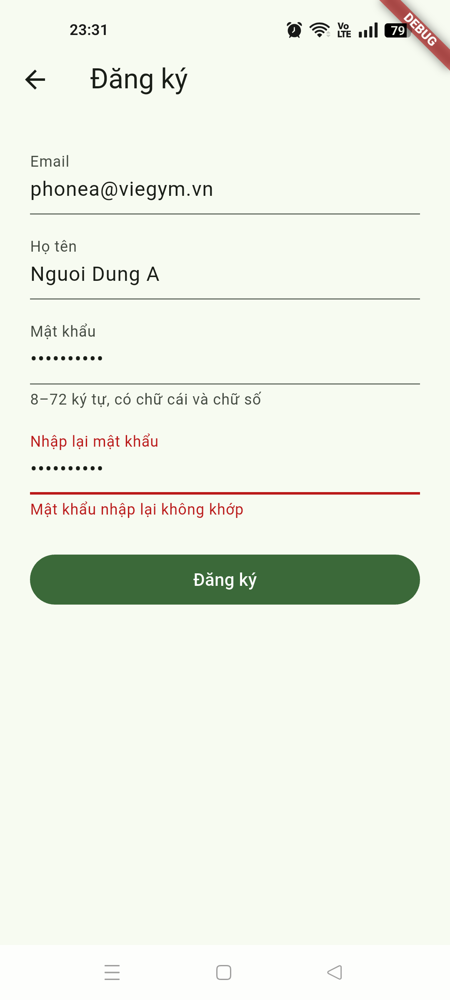
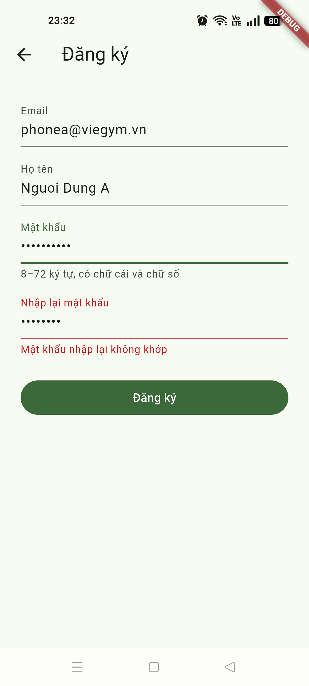

# Ngày 4 — Kết quả kiểm tra xác thực và phiên

Ngày kiểm tra: 2026-10-26 (integration test, đăng ký trên Android); 2026-10-27 (chạy lại toàn bộ test, luồng phiên trên Android). Thiết kế: `09-auth-design.md`. Chỉ ghi kết quả đã chạy thật.

## 1. Môi trường

| Thành phần | Phiên bản / cấu hình |
|---|---|
| Backend | Spring Boot 4.1.1, Spring Security OAuth2 Resource Server, JDK 24 (`release 21`) |
| Database | PostgreSQL 17 (`infra-postgres-1`); Flyway áp dụng V2 `create auth tables` |
| Test backend | JUnit + Testcontainers (PostgreSQL container riêng, khóa JWT sinh lúc chạy), không đụng DB demo |
| Mobile | Flutter 3.47.7; `flutter_secure_storage` 11.2.0 |
| Thiết bị | OPPO CPH2565, Android 15, USB + `adb reverse tcp:8080 tcp:8080` |
| TTL | Access 15 phút, refresh 30 ngày, phiên 30 ngày (không rút ngắn khi kiểm tra) |

## 2. Kiểm thử tự động

| Lệnh | Kết quả 2026-10-27 |
|---|---|
| `backend> .\mvnw.cmd test` | ✅ 15/15: `AuthFlowIntegrationTests` 14, `BackendApplicationTests` 1 |
| `mobile> flutter analyze` | ✅ `No issues found!` |
| `mobile> flutter test` | ✅ 10/10: `auth_repository_test` 8, `widget_test` 2 |

## 3. API (integration test, PostgreSQL thật)

| Mã | Tình huống | Mong đợi | Thực tế | Test |
|---|---|---|---|---|
| AUTH-01 | Register hợp lệ | 201, USER | ✅ | `registerCreatesUserAndIgnoresClientRole` |
| AUTH-02 | Email trùng khác hoa/thường | 409 `EMAIL_ALREADY_EXISTS` | ✅ | `duplicateEmailIgnoringCaseIsConflict` |
| AUTH-03 | Dữ liệu thiếu/sai | 400, lỗi theo trường | ✅ | `invalidRegisterReturnsFieldErrors` |
| AUTH-04 | Client gửi `role: ADMIN` | Vẫn tạo USER | ✅ | `registerCreatesUserAndIgnoresClientRole` |
| AUTH-05 | Login đúng | 200, cặp token, `Cache-Control: no-store` | ✅ | `loginReturnsTokensAndMeReturnsOnlyOwner`, `loginResponseIsNotCached` |
| AUTH-06 | Sai mật khẩu / email không tồn tại | Cùng 401 `INVALID_CREDENTIALS`, không token | ✅ | `wrongPasswordAndUnknownEmailGiveSameError` |
| — | Login kèm Bearer cũ | Không bị chặn | ✅ | `staleBearerHeaderDoesNotBlockLogin` |
| AUTH-07 | `/users/me` không token | 401 | ✅ | `meWithoutTokenIsUnauthorized` |
| AUTH-08 | JWT giả, hết hạn, sai iss/aud | 401 | ✅ | `forgedExpiredOrForeignTokensAreRejected` |
| AUTH-09 | Token A gọi me | Chỉ trả A | ✅ | `loginReturnsTokensAndMeReturnsOnlyOwner` |
| AUTH-10 | USER gọi `/api/v1/admin/**` | 403 | ✅ | `userCannotCallAdminApi` |
| AUTH-11 | Refresh hợp lệ | Token mới, cũ bị tiêu thụ | ✅ | `refreshRotatesAndReuseRevokesSessions` |
| AUTH-12 | Gửi lại refresh cũ | 401; mọi phiên của user bị thu hồi (BR-A04) | ✅ | `refreshRotatesAndReuseRevokesSessions` |
| AUTH-13 | Hai refresh đồng thời cùng token | Đúng một request 200 | ✅ | `concurrentRefreshWithSameTokenSucceedsOnce` |
| AUTH-14 | Logout rồi dùng access/refresh cũ | Bị từ chối; phiên khác của user vẫn dùng được | ✅ | `logoutRevokesOnlyCurrentSession` |
| AUTH-15 | Khóa tài khoản ở DB | Login/refresh/API riêng tư bị chặn | ✅ | `lockedAccountIsBlockedEverywhere` |

## 4. Android (kiểm tra tay)

Tài khoản test: A `phonea@viegym.vn`, B `phoneb@viegym.vn`. Người kiểm tra tự thao tác trên máy và xác nhận từng bước đúng như cột "Mong đợi". Lần này không chụp ảnh. Bằng chứng phía server lấy từ DB sau khi kiểm tra (mục 5).

| # | Mã | Thao tác | Mong đợi | Thực tế |
|---|---|---|---|---|
| 1 | — | Đăng ký A, mật khẩu nhập lại không khớp | Báo lỗi tại ô, không gửi | ✅ (ảnh 01, 02) |
| 2 | AUTH-01 | Đăng ký A hợp lệ (2026-10-26) | Về màn đăng nhập | ✅ bản ghi `phonea@viegym.vn`, USER, ACTIVE |
| 3 | AUTH-06 | Login A sai mật khẩu | Báo lỗi, ở lại màn đăng nhập | ✅ |
| 4 | AUTH-05 | Login A đúng | Màn "Phiên đăng nhập": Nguoi Dung A, USER | ✅ |
| 5 | AUTH-17 | Tắt hẳn app, mở lại | Vào thẳng phiên, không cần đăng nhập | ✅ |
| 6 | AUTH-18 | Tắt app, rút USB, mở app | Màn lỗi có "Thử lại", không về màn đăng nhập. Cắm lại + Thử lại → vào phiên | ✅ |
| 7 | AUTH-16 | Restart backend (cùng khóa), bấm "Tải lại từ máy chủ" | Vẫn hiện A | ✅ |
| 8 | Logout | Đăng xuất, tắt rồi mở lại app | Màn đăng nhập, không có cảnh báo "chưa xác nhận" | ✅ |
| 9 | AUTH-19 | Đăng ký B, đăng nhập B | Chỉ hiện dữ liệu B, không còn A | ✅ |
| 10 | Logout | Đăng xuất B | Màn đăng nhập | ✅ |

| 01. Nhập lại không khớp | 02. Nhập lại không khớp (khác độ dài) |
|---|---|
|  |  |

Ảnh không chứa token.

## 5. Đối chiếu database sau kiểm tra tay (2026-10-27)

| Truy vấn | Kết quả | Ý nghĩa |
|---|---|---|
| Phiên của A | 1 phiên, 3 refresh token, 2 đã consumed, phiên đã thu hồi | Login + 2 lần khôi phục (bước 5, 6) xoay vòng token; logout thu hồi phiên. Login sai không tạo phiên |
| Phiên của B | 1 phiên, 1 token, đã thu hồi | Login + logout |
| Tiền tố `password_hash` | `{bcrypt}` cho cả 2 user | Mật khẩu hash BCrypt |
| `refresh_tokens.token_hash` | 4/4 dài 64 ký tự hex | Chỉ lưu SHA-256, không lưu token gốc |

## 6. Bảo mật repo

- `infra/secrets/jwt-*.pem` bị `.gitignore` chặn (`secrets/`, `*.pem`). Đã kiểm tra bằng `git check-ignore`.
- `TokenResponse`, `RegisterRequest` override `toString()` để không in token/mật khẩu ra log.

## 7. Còn tồn tại

| Vấn đề | Ảnh hưởng | Hướng xử lý |
|---|---|---|
| Refresh đồng thời cùng token thu hồi mọi phiên của user, kể cả request thắng (BR-A04) | Client không có single-flight bị đăng xuất | Chủ ý; app đã có single-flight. Ghi ở `09-auth-design.md` §5 |
| Chưa giới hạn tần suất đăng nhập | Có thể dò mật khẩu | Làm cùng rate limit của BR-A06 |
| Chưa có job dọn phiên/token hết hạn | Bảng tăng dần | Thêm ở phần vận hành |
| Gboard Telex làm sai ký tự trong ô mật khẩu khi điều khiển qua `adb` | Chỉ ảnh hưởng thao tác test tự động | Kiểm tra tay bằng bàn phím English |
| Access hết hạn thật trên thiết bị (sau 15 phút) chưa kiểm tra tay | Logic đã có test tự động (single-flight, retry một lần) | Kiểm tra khi dùng app lâu ở các ngày sau |
